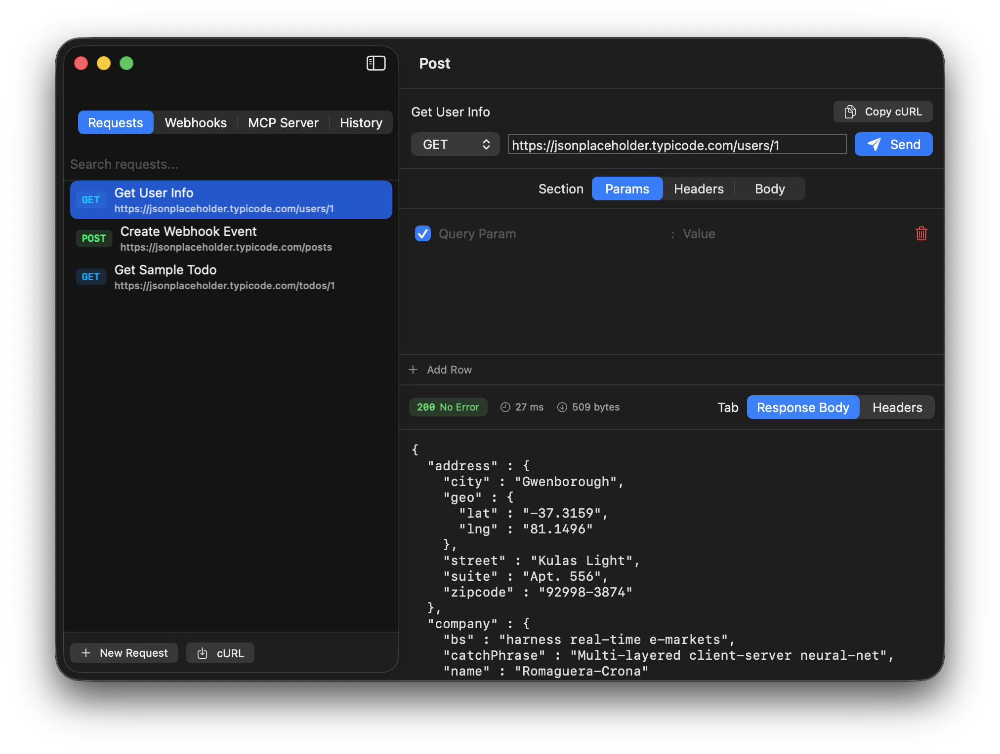
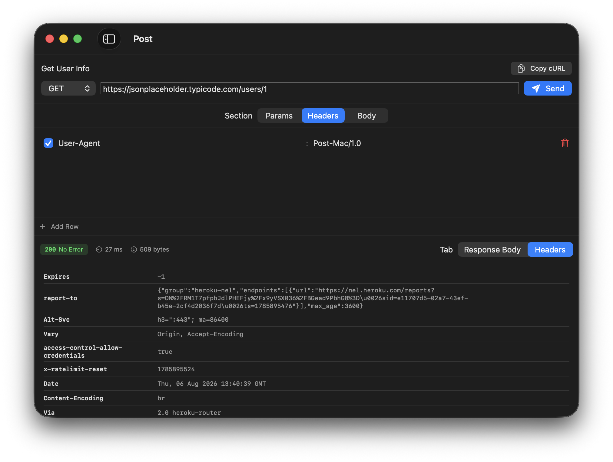
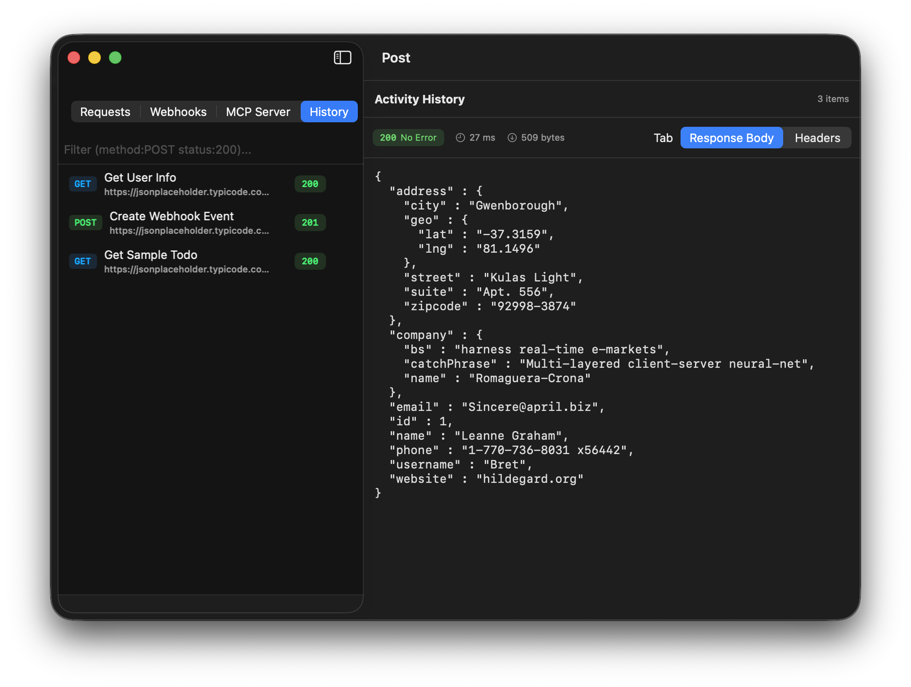

# Post

A native, lightweight macOS desktop application for HTTP API testing, local webhook debugging, and Model Context Protocol (MCP) tool inspection. Built with Swift 6, AppKit, and SwiftUI.

---

## Interfaces & Features

### HTTP Workbench
Build and execute HTTP requests (`GET`, `POST`, `PUT`, `DELETE`, `PATCH`) with custom headers, query parameters, and JSON payloads. Includes timing measurements, status badges, and 1-click cURL export/import.



---

### Request & Response Headers
Inspect outgoing request headers alongside detailed server response header metadata.



---

### Local Webhook Server
Embedded network listener (`NWListener`) running on port `9090` (configurable) to capture, format, and inspect incoming webhook payloads from local services in real time.


---

### MCP Tool Inspector
Connect to local HTTP/SSE Model Context Protocol servers, discover available tools (`tools/list`), edit input parameters, and execute JSON-RPC 2.0 tool calls (`tools/call`).


---

### Tokenized Activity History
Search past activity logs using tokenized queries (`method:POST status:200`) and inspect response bodies or headers.



---

## Quick Reference

* **User Manual**: Check out the comprehensive [User Guide](docs/USER_GUIDE.md) for step-by-step instructions.
* **Native macOS UX**: Suppresses phantom autofill and predictive text popups via layered AppKit field editor interceptors (`FilterField`).

---

## Architecture & Requirements

* **Platform**: macOS 15.0+
* **Toolchain**: Swift 6.0+
* **Dependencies**: Native macOS frameworks (`AppKit`, `SwiftUI`, `Network`, `Foundation`)

```
Sources/Post/
├── App/
│   ├── PostApp.swift
│   └── PostAppDelegate.swift
├── Engine/
│   ├── HTTPClient.swift
│   ├── CURLParser.swift
│   ├── WebhookServer.swift
│   └── MCPClient.swift
├── Models/
│   ├── HTTPRequest.swift
│   ├── HTTPResponse.swift
│   ├── WebhookPayload.swift
│   ├── MCPServer.swift
│   └── HistoryItem.swift
├── Storage/
│   └── PostStore.swift
└── Views/
    ├── MainContentView.swift
    ├── SidebarView.swift
    ├── RequestBuilderView.swift
    ├── ResponseView.swift
    ├── WebhookServerView.swift
    ├── MCPInspectorView.swift
    └── Components/
        ├── FilterField.swift
        ├── NoAutoFillWindowSetup.swift
        └── StatusBadge.swift
```

---

## Getting Started

### Build

```bash
make build
```

### Run Unit Tests

```bash
make test
```

### Bundle & Deploy Locally

To compile the release bundle and install to `/Applications/Post.app`:

```bash
make deploy
```

---

## License

Distributed under the [MIT License](LICENSE).
