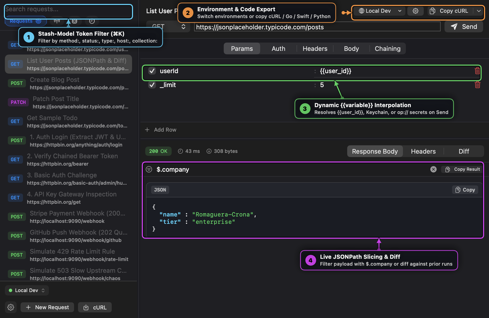
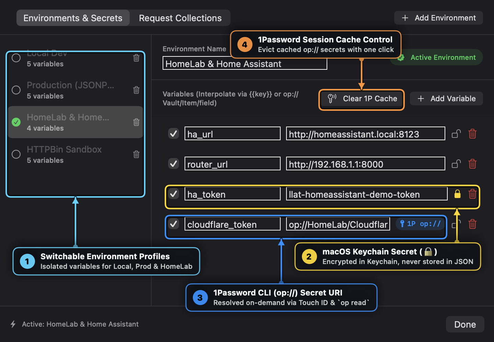
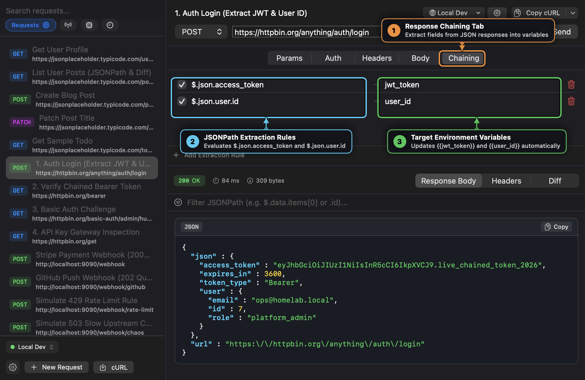
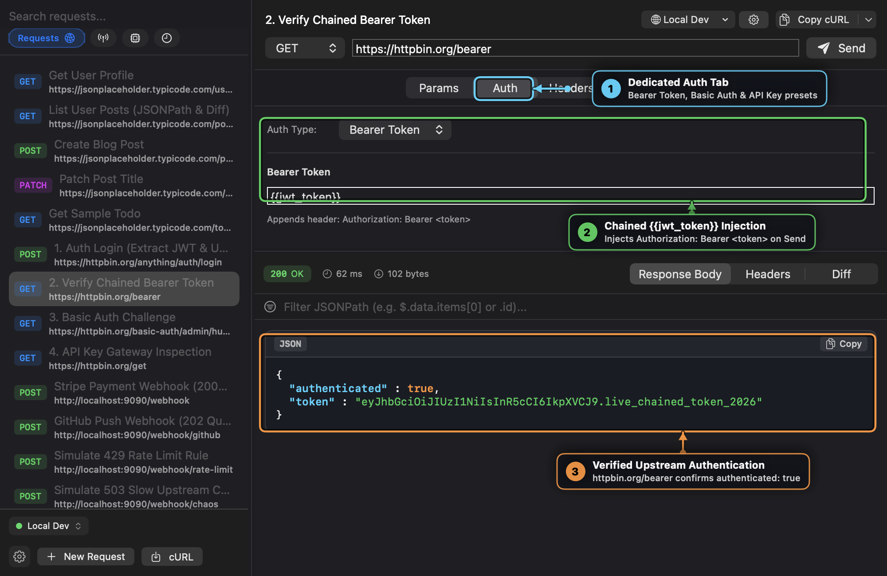
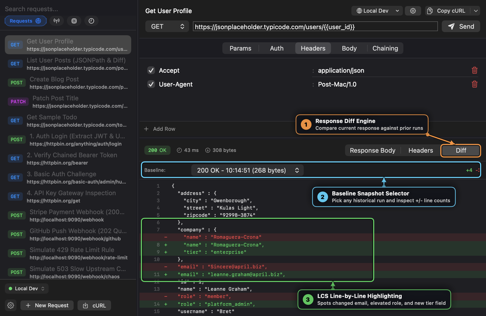
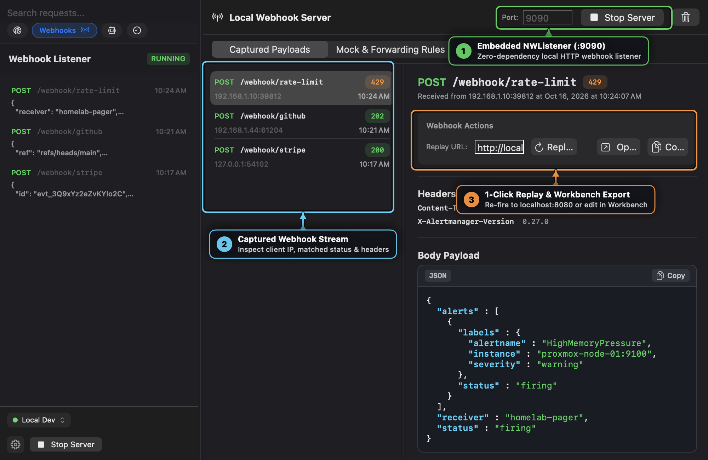
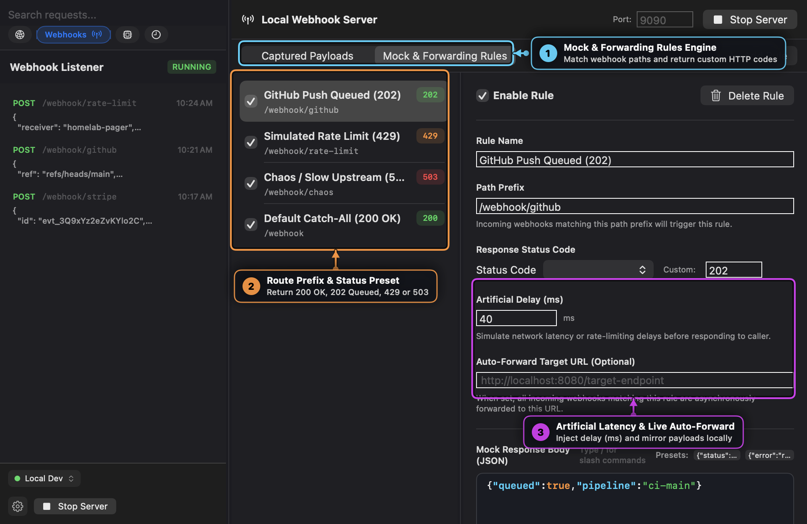
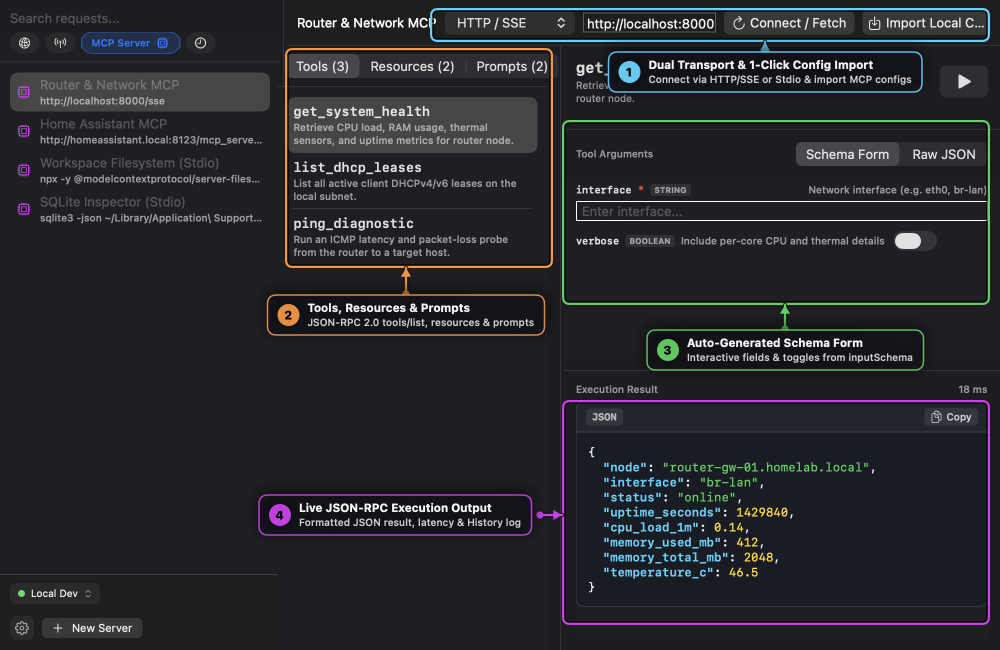

# Post

A native, lightweight macOS desktop application for HTTP API testing, local webhook debugging, and Model Context Protocol (MCP) tool inspection. Built with Swift 6, AppKit, and SwiftUI.

---

## Interfaces & Visual Tour

### 1. HTTP Workbench, Live JSONPath & Multi-Language Code Export
Build and execute HTTP requests (`GET`, `POST`, `PUT`, `DELETE`, `PATCH`, `HEAD`, `OPTIONS`) with custom headers, query parameters, URL-encoded forms, and raw JSON payloads.



* **① Stash-Model Token Filter (`⌘K`)**: Filter requests and history by `method:`, `status:`, `type:`, `host:`, and `collection:` using non-intrusive keyboard navigation.
* **② Environment & Code Export**: Switch active environments on the fly or export any tested request as runnable **cURL**, **Go (`net/http`)**, **Swift (`URLSession`)**, or **Python (`httpx`)** code.
* **③ Dynamic `{{variable}}` Interpolation**: Reference `{{user_id}}`, macOS Keychain secrets, or `op://` 1Password URIs across URLs, query parameters, headers, auth, and bodies.
* **④ Live JSONPath Slicing & Diff**: Query nested JSON responses in real time (e.g., `$.company`) or switch to the **Diff** tab to inspect line-by-line regressions.

---

### 2. Multi-Environment, macOS Keychain & 1Password (`op://`) Secret Management
Switch seamlessly between isolated environments (`Local Dev`, `Production`, `HomeLab & Home Assistant`, `HTTPBin Sandbox`) without exposing credentials in plain-text configuration files.



* **① Switchable Environment Profiles**: Maintain separate variable sets for local microservices, staging clusters, and production APIs.
* **② macOS Keychain Integration (`🔒`)**: Toggle the lock icon on any variable to store its value encrypted in the native macOS Keychain (`com.msjurset.post-mac.env`) instead of `workspace.json`.
* **③ 1Password CLI (`op://`) Secret References**: Paste any `op://Vault/Item/field` reference (or use `{{op://Vault/Item/field}}` inline). Post resolves secrets on-demand via `op read` with native Touch ID and caches them in memory for the session.
* **④ 1Password Session Cache Control**: Evict cached `op://` secrets from memory at any time with a single click on **Clear 1P Cache**.

---

### 3. Zero-Copy Auth Chaining & Dedicated Auth Presets
Eliminate manual copying and pasting of short-lived JWTs and session tokens across dependent endpoints.



* **① Response Chaining Tab**: Define post-response extraction rules directly on login or token-issuing endpoints.
* **② JSONPath Extraction Rules**: Extract deeply nested response values such as `$.json.access_token` and `$.json.user.id` automatically whenever the request succeeds.
* **③ Target Environment Variables**: Extracted values immediately update `{{jwt_token}}` and `{{user_id}}` in the active environment.



* **① Dedicated Auth Tab**: First-class presets for **Bearer Token**, **Basic Auth** (`username`/`password`), and **API Key** (Header or Query Param).
* **② Chained `{{jwt_token}}` Injection**: Downstream requests reference `{{jwt_token}}` and automatically inject `Authorization: Bearer <token>` at execution and code-export time.
* **③ Verified Upstream Authentication**: Instant visual verification of authenticated responses.

---

### 4. Response Diff Engine & Regression Auditing
Compare the current API response against any previous execution in your history to spot schema changes, mutated values, or unexpected regressions.



* **① Response Diff Engine**: Switch to the **Diff** tab in the Response pane after running a request multiple times.
* **② Baseline Snapshot Selector**: Choose any historical execution snapshot and view added (`+`) and removed (`-`) line counts at a glance.
* **③ LCS Line-by-Line Highlighting**: Longest-Common-Subsequence diffing highlights added fields in green and removed/changed fields in red.

---

### 5. Local Webhook Server, Mock Rules, Latency Injection & Live Replay
Embedded network listener (`NWListener`) running on port `9090` (configurable) to capture, mock, forward, and replay incoming HTTP webhooks without external tunnels.



* **① Embedded `NWListener` (`:9090`)**: Zero-dependency local HTTP listener with automatic `Content-Length` multi-chunk body assembly.
* **② Captured Webhook Stream**: Real-time stream displaying HTTP method, path, client IP, timestamp, and the status code returned (`200`, `202`, `429`, `503`).
* **③ 1-Click Replay & Workbench Export**: Re-fire any captured webhook payload to a local microservice (e.g., `http://localhost:8080/webhook`) or click **Open in Workbench** to edit and test it as a standard HTTP request.



* **① Mock & Forwarding Rules Engine**: Switch between **Captured Payloads** and **Mock & Forwarding Rules** to control how the webhook listener responds.
* **② Route Prefix & Status Presets**: Match incoming paths (e.g., `/webhook/github`, `/webhook/rate-limit`, `/webhook/chaos`) and return custom status codes (`200 OK`, `202 Accepted`, `429 Too Many Requests`, `503 Service Unavailable`).
* **③ Artificial Latency & Live Auto-Forward**: Inject artificial network delay (`ms`) to test client timeouts/retries and automatically mirror incoming webhooks to a target URL.

---

### 6. Dual-Transport Model Context Protocol (MCP) Inspector
Connect to Model Context Protocol (MCP) servers over both **HTTP / SSE** and **`stdio` subprocess** transports to audit tools, resources, and prompts.



* **① Dual Transport & 1-Click Config Import**: Connect via **HTTP / SSE** or spawn a local **Stdio Command** (`npx`, `uvx`, `python3`, `sqlite3`), or click **Import Local Configs** to auto-discover servers from Claude Desktop, Cursor, and AGY.
* **② Tools, Resources & Prompts**: Full JSON-RPC 2.0 lifecycle inspection across `tools/list`, `resources/list`, `resources/read`, and `prompts/list`.
* **③ Auto-Generated Schema Form**: Parses each tool's JSON Schema (`inputSchema`) into native fields and boolean toggles alongside a Raw JSON editor.
* **④ Live JSON-RPC Execution Output**: Execute `tools/call` with a single click, inspect formatted results and execution latency, and log runs to History.

---

### 7. Code Syntax Highlighting, Vim Engine, Slash Commands & Settings (`⌘,`)
Every multiline payload editor and response block in Post features dark code syntax highlighting, optional Vim modal editing (`swift-vim-engine`), and a dynamic-growth slash command bar:

* **Live Syntax Highlighting**: Color-codes JSON keys, strings, numbers, booleans/null, `{{template}}` environment variables, `op://` 1Password secret references, and cURL shell commands.
* **Subtle Vim Watermark Toggle (`:_`)**: Enabling Vim support in Settings never forces text areas into Vim mode by default—every field starts in standard macOS editing mode (`VIM=OFF`). Click the subtle `:_` watermark in the bottom-right corner of any multiline editor (or type `/vim`) to enter `VIM:N` / `VIM:I` / `VIM:V` mode with a built-in `?` keybinding cheatsheet popover.
* **Dynamic-Growth Slash Command Bar**: Type `/` at the start of a line to expand the editor with interactive command pills (`/vim`, `/pretty`, `/json`, `/graphql`, `/uuid`, `/iso8601`, `/timestamp`, `/op`, `/env`, `/clear`). Cycle pills with `Tab` / `Shift+Tab` / arrow keys and press `Enter` or `Space` to execute.
* **Bottom-Left Settings Cog (`⌘,`)**: Click the `⚙` cog in the bottom-left of the sidebar to individually toggle **Slash Commands**, **Vim Mode Support**, and **Code Syntax Highlighting**.

| Shortcut | Action |
| :--- | :--- |
| `⌘ + Return` | Execute Selected Request |
| `⌘ + N` | Create New HTTP Request |
| `⌘ + K` or `⌘ + F` | Focus Stash-Model Token Search Bar |
| `⌘ + E` | Open Environments, Secrets & Collections Manager |
| `⌘ + ,` | Open Editor Settings (Slash Commands, Vim Mode, Syntax Highlighting) |
| `Tab` / `Shift + Tab` | Open or cycle auto-suggest dropdown / slash command pills |
| `Esc` | Dismiss suggestion dropdown / exit Vim Insert or Visual mode |

---

## Documentation

* **[Visual User Guide (`docs/USER_GUIDE.md`)](docs/USER_GUIDE.md)**: Complete visual walkthrough of every screen, control, and annotated callout.
* **[Engineering Cookbook (`docs/COOKBOOK.md`)](docs/COOKBOOK.md)**: 7 end-to-end practical recipes with annotated screenshots for secret management, auth chaining, webhook chaos testing, MCP inspection, and code generation.

---

## Architecture & Build

* **Platform**: macOS 14.0+ / 15.0+
* **Toolchain**: Swift 6.0+
* **Dependencies**: `swift-vim-engine` + native Apple frameworks (`AppKit`, `SwiftUI`, `Network`, `Security`, `Foundation`)

```bash
# Build debug binary
make build

# Run unit tests (and regenerate annotated documentation screenshots)
swift test

# Build release bundle and install to /Applications/Post.app
make deploy
```

---

## License

Distributed under the [MIT License](LICENSE).

