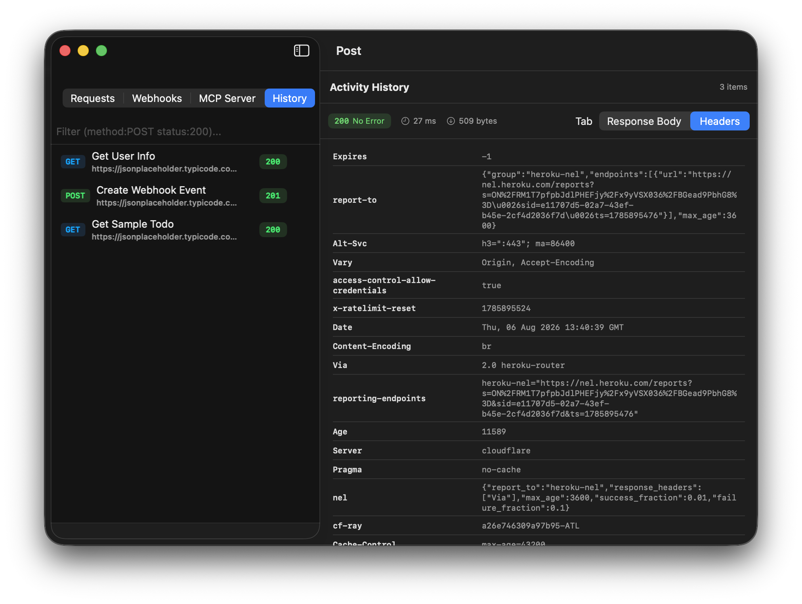

# Post User Guide & Visual Walkthrough

A complete visual walkthrough and user manual for **Post**, a native macOS application for HTTP API testing, local webhook debugging, and Model Context Protocol (MCP) tool inspection.

---

## Table of Contents

1. [HTTP Workbench](#1-http-workbench)
2. [Request Headers & Response Headers](#2-request-headers--response-headers)
3. [Local Webhook Listener](#3-local-webhook-listener)
4. [MCP Tool Inspector](#4-mcp-tool-inspector)
5. [Tokenized Search & Activity History](#5-tokenized-search--activity-history)
6. [cURL Import & Export](#6-curl-import--export)

---

## 1. HTTP Workbench

The HTTP Workbench is your primary workspace for building, configuring, and executing HTTP API calls.

### Key Workflows:
* **Create Request**: Click **+ New Request** in the sidebar footer.
* **Method & Endpoint URL**: Select `GET`, `POST`, `PUT`, `DELETE`, `PATCH`, `HEAD`, or `OPTIONS` and enter your endpoint URL. Pressing `Enter` while inside the URL bar immediately fires the request.
* **Params Section**: Add query string key-value pairs (`?key=value`). Toggle individual rows on or off using the checkboxes.
* **Response Inspection**: View status code badges (e.g. `200 No Error` in green), latency (`27 ms`), payload size (`509 bytes`), and formatted JSON output.

---

## 2. Request Headers & Response Headers

Post gives you side-by-side visibility over outgoing headers and incoming server response headers.

### Header Workflows:
* **Request Headers**: Add custom headers like `User-Agent: Post-Mac/1.0`, `Authorization`, or `Content-Type`.
* **Response Headers**: Switch the bottom inspector tab to **Headers** to view full server header metadata (`Date`, `Content-Encoding`, `Server`, `Cache-Control`, `x-ratelimit-reset`).

---

## 3. Local Webhook Listener

Test and debug webhooks sent by local microservices, Home Assistant, Stripe, or third-party integrations.

### Webhook Workflows:
1. Switch to the **Webhooks** tab in the sidebar.
2. Set your target listening port (default: `9090`).
3. Click **Start Listener**.
4. Send incoming webhooks to `http://localhost:9090/webhook`.
5. Incoming payloads log in real time with client IP, timestamp, raw HTTP headers, and formatted JSON body inspection.

---

## 4. MCP Tool Inspector

Connect directly to Model Context Protocol (MCP) servers to test AI tool calls.

### MCP Workflows:
1. Switch to the **MCP Server** tab in the sidebar.
2. Enter your local MCP endpoint (e.g. `http://localhost:8000/sse`) and click **Connect / Fetch Tools**.
3. Browse discovered tools returned by `tools/list`.
4. Fill in tool arguments in the JSON editor and click **Execute Tool** to fire JSON-RPC `tools/call` requests.

---

## 5. Tokenized Search & Activity History

Search across past executions and inspect formatted responses or raw headers.

### Response Body History:

### Response Headers History:

### Tokenized Filter Queries:
Filter activity history using exact attribute tokens in the search field:
* `method:POST`: Show only POST requests or history items.
* `status:200`: Filter history items returning HTTP 200.
* `type:Webhook`: Show captured webhooks in activity history.

---

## 6. cURL Import & Export

* **cURL Import**: Click **cURL** in the sidebar footer and paste any raw command (e.g., `curl -X POST https://api.example.com -H 'Content-Type: application/json' -d '{"key":"val"}'`).
* **cURL Export**: Click **Copy cURL** in the top right header to copy the exact runnable command to your macOS Clipboard.
